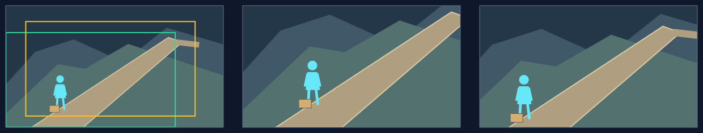

# 斜向平移：顺着斜向空间联系观看

## 适用条件

**斜向包括右上↗、左上↖、右下↘、左下↙，角度随画面联系决定，不固定为45°。** 下方只演示左下到右上；当前镜头从哪里看向哪里，由自己的场景与观看顺序决定。

坡道、河岸、栈桥、队列或视线在同一图中沿斜线展开；这条方向关系参与表达，而非为显得有变化。两轴同时移动后，必要主体与连接仍有可用空间，实际画面不会切断路口或动作。

源图需要同一观察位置和可理解的纵深。图中的斜线可以是透视投影，但移动窗口本身不会沿路进入远方、也不会绕过障碍。

## 选择理由

顺着已存在的路径看，比单纯横移或上下移更能保住联系，并让沿途距离可感。代价是两轴都在裁去区域，某个对象容易从角上丢失；只有真实收益足以承担这种取景成本时才选。

## 典型应用场景

| 场景范围 | 常见内容 | 为什么选它／画面前提 |
|---|---|---|
| 沿斜向通路理解距离与去向 | 道路、坡面、栈桥、河岸或斜列在图中连接人物与目的地 | 沿路径观看能保留途中联系；图上已有连续路面，移框不会真的走入纵深。 |
| 连接错层错位的两端 | 近处行动与远处响应、坡脚与高处目标、斜向分布的协作或对峙 | 横移或竖移都会割裂关系时，两轴一起移动更合适；两端及连线在实际框内可辨，不能只因斜移少用而选它。 |

这些是可迁移的用途范围。下方只完整演示其中一例，人物、地点与方向随当前内容重新设计。

## 本例实操

原创虚构例，旁白：“他在坡下停住，前面的路还很长。”

**场面构思：** 已选坡下停步、前路延伸的瞬间；`entryFocus`为坡下停步的人，`landingFocus`为人与前路，`viewerChange`为体会停步背后的路程负担。以下在联合设计落实这个任务。

### 构图与选择

1. **完整场景：** 从道路侧前方看，近处坡脚与行囊，中部人物和连续坡路，后方路口与山体延伸。人物在x≈0.25、y=0.57—0.85，目标路口在x≈0.76、y≈0.32。路面从人物脚边连向右上，不能仅用一条无着落的装饰斜线。
2. **入口到末态：** 起初人物的停步最明确；顺路向右上移动，路口及中间距离获得更多空间。人物仍在左下可辨，动作与去向可以共同读到。
3. **选择：** 当前构图里人物与路口沿斜线相连，沿路移框能让距离获得分量，同时保留停步者。写`motion.type = traverse`，框保持等大，方向随这条实际道路选择。

### 取景参数与图例

本例选择`motion.speedRatio = 1.1`（110%），使用8秒、60fps的单图练习，无接镜余量；实际运动到末帧约7.983秒。下列是本例的`(x, y, width, height)`，不是推荐值。正式节目使用原工作单的真实预算。

| 起框 | 语义终框 | 程序返回的实际末框 |
|---|---|---|
| `(0, 0.22, 0.78, 0.78)` | `(0.22, 0, 0.78, 0.78)` | `(0.0912, 0.1288, 0.78, 0.78)` |

坡下人物、连续道路与上方目的地形成一条空间关系。看向右上时，仍保住人物及足以理解去向的道路。

**图例从左到右：** 完整源图及取景框 → 起始取景 → 实际末态。绿框为起框，黄框为实际末框；右格不是理论路线终点。

### 复核与衔接

4. **看实际框：** 按实际末态检查人物脚边、路径连接和目标路口，尤其是左下和右上两个角。约8秒只移动本例全路径的一部分，已经需要的关系应在实际框内成立；不能承诺沿路线最终“抵达”。不足时联合重排坡路投影、人物位置与框，保留顺路观看。
5. **接缝：** 前后镜方向相近可以延续观看感觉，但两个不同场地的斜线不自动成为同一物理路线；`cameraRelation`按真实依赖填写。

## 怎样迁移

四个斜向象限和不同斜率都可选，起终点也不必在图像角落；沿当前图中的具体关系形成路线。弯路需要中途点时，每个点都应有具体观看作用，并保持现行路线不反向折返；普通两点够用就保留两点。
