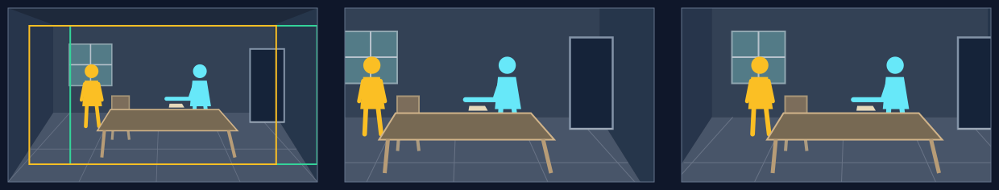

# 横向平移：沿同一空间读出联系

## 适用条件

同一现场的关键对象主要沿左右展开，中间有桌面、地面、队列、视线或行动路径连接。它们在现有尺度下已经够大，观看收益来自依次读两端及关系，而不是放大细节。源图两侧都有完整场地。

横向移动不必让一个对象消失、另一个才出现。两端始终可见时，应靠相对位置、主次与具体动作支持观看转移；只有框的中心变了，不能证明焦点变了。

## 选择理由

尺度保持稳定，观看像沿一段关系浏览。相比推拉，横移把时间花在空间两端和连接上；相比沿边缘揭示，它不依赖隐藏信息。左右方向由原场地和观看顺序决定，向左并不天然悲观，向右也不天然推进。

## 典型应用场景

| 场景范围 | 常见内容 | 为什么选它／画面前提 |
|---|---|---|
| 读同场人物之间的关系 | 交接、对峙、协作、等待回应等双方或多方关系 | 维持人物尺度，沿视线、桌面或空隙转移注意；两端及中间联系都要可读。 |
| 介绍横向展开的场地 | 街道、河岸、工场、营地、队列的布局和分布 | 依次读区域能建立方位与规模；沿途是连通现场，各处有可辨差异。 |
| 顺着现场中的行动联系观看 | 沿已经呈现的交接链、搬运路径、部署关系寻找下一处重点 | 空间顺序帮助读懂联系，免于逐个推近割裂整体；同图展示的是一个时刻，不靠移框制造动作完成。 |

这些是可迁移的用途范围。下方只完整演示其中一例，人物、地点与方向随当前内容重新设计。

## 本例实操

原创虚构例，旁白：“东西已经送到，接收的人却没有伸手。”

**场面构思：** 已选递出而未接的瞬间；`entryFocus`为送件动作，`landingFocus`为接收者没伸出的手及间隔，`viewerChange`为体会递出后尚未得到接应的停顿。以下在联合设计落实这个任务。

### 构图与选择

1. **构场：** 完整交接厅，近处地板、中部长桌与两人、后方墙和门相连。右侧送件者身体前倾，托着物件；左侧接收者站直、双手留在自己一侧。两人可见部分约占图高36%，桌面保留两手之间的距离。观察者站在桌侧，能同时读姿态和空隙。
2. **取景：** 入口优先送件的姿态；向左平移后，接收者靠近主观看区，送件者的手与桌面间隔仍可见。左侧人物以轮廓和光获得分量，右侧退为关系中的另一端。
3. **选择：** 要依次读双方不同反应，当前构图中等大平移能保留两端及间隔，使接收者逐渐获得分量。写`motion.type = traverse`，无中途点。

### 取景参数与图例

本例选择`motion.speedRatio = 1.1`（110%），使用8秒、60fps的单图练习，无接镜余量；实际运动到末帧约7.983秒。下列是本例的`(x, y, width, height)`，不是推荐值。正式节目使用原工作单的真实预算。

| 起框 | 语义终框 | 程序返回的实际末框 |
|---|---|---|
| `(0.2, 0.1, 0.8, 0.8)` | `(0, 0.1, 0.8, 0.8)` | `(0.0677, 0.1, 0.8, 0.8)` |

横向可向左也可向右；下图只示向左，选择取决于本图的阅读顺序。

入口先读右侧送件者及其伸出的手，随后左侧接收者和两人间桌面获得更充分的位置。两个人本已在场，图例没有把它画成凭空出现。

**图例从左到右：** 完整源图及取景框 → 起始取景 → 实际末态。绿框为起框，黄框为实际末框；右格不是理论路线终点。

### 复核与衔接

4. **读实际效果：** 两手和中间空隙持续可读；接收者的尺度与明暗足以承接注意。若始终只看见一张长桌，改主体分量和姿态；若移到末态仍由送件者抢眼，先调整画面主次，不把焦点文字当成完成。
5. **接缝：** 前图若已经表达“递出而未接”，比较此图是否增加新内容；当前图的方向可延续也可独立起镜，依据两镜关系而非交替表。

## 怎样迁移

队列两端、堤岸与船、隔桌相对等都可使用。两端相距过远时，先改变观察角度、人物调度或空间尺度，让既定窗口足够读到关系；保留横向观看的意图。需要真的后来才出现的对象，进一步读[揭示平移](pan-reveal.md)。
