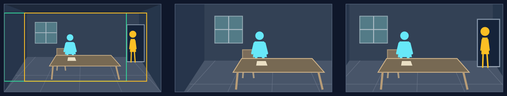

# 揭示平移：让框外的新区域改变理解

## 适用条件

新对象位于同一完整场景中，其必需辨认部分确实在入口框之外；沿既定方向平移可把它带入。观众先看到的部分能建立期待，新区域加入后增加、改变或限定理解，并有足够时间读清。

框外与遮挡不同：一个人被实墙挡住，即使移动同一静图的取景框，也不会穿过墙看见他。当前可增加的边缘有限，不能在窄条里安排一整队人物的惊喜登场。

## 选择理由

这里选择的是**信息进入的顺序**。比普通横向浏览更依赖初始不可见；比拉远更适合新区域集中在某一侧、主体大小需要保持的画面。惊讶不必很强，温和地发现一个等待者同样成立。

## 典型应用场景

| 场景范围 | 常见内容 | 为什么选它／画面前提 |
|---|---|---|
| 补入原先未知的参与者 | 等待者、旁观者、回应者或另一方进入观众视野 | 先前动作因多出一人而有新含义；此人的必要轮廓起初在框外，进入后与原人物同属一个现场。 |
| 从已见状态找到关联对象 | 从视线或手势读到所指之物，从痕迹读到邻近相关物 | 观看方向把问题与对象接起来；关联须有内容依据，目标在实际可扫入区域，不能藏在实物背后。 |
| 逐步显出行动的条件或后果 | 通路边缘的阻碍、任务旁的资源、现场边上的损耗或结果 | 后加入的信息限定先前理解；需要给新区域辨认时间，不能只在末帧露出一点。 |

这些是可迁移的用途范围。下方只完整演示其中一例，人物、地点与方向随当前内容重新设计。

## 本例实操

原创虚构例，旁白：“他还在整理文件。门边的人，已经等了一会儿。”

**场面构思：** 已选桌前忙碌、门边等候的同一瞬间；`entryFocus`为桌前工作的人，`landingFocus`为门边等待者和二人距离，`viewerChange`为发现等待关系。以下在联合设计落实这个任务。

### 构图与选择

1. **完整场景：** 桌前人位于房间中部偏左，右后门洞、地板和桌椅之间有真实通路。门边人占原图约x=0.795—0.845、y=0.30—0.66；用完整站姿和门框区分人物，不靠可读文字或身份细节。
2. **设计顺序：** 初框右界为0.78，门边人尚不可见；向右扫过后轮廓完整进入。桌前人维持在画面内，等待者与他共同构成关系，显露不等于独占画面。
3. **选择：** 这句需要先看忙碌，再补充“另有人等着”。写`motion.type = traverse`，向右移动，等大框保住站姿尺度，按已定次序使等待者进入视野。

### 取景参数与图例

本例选择`motion.speedRatio = 1.1`（110%），使用8秒、60fps的单图练习，无接镜余量；实际运动到末帧约7.983秒。下列是本例的`(x, y, width, height)`，不是推荐值。正式节目使用原工作单的真实预算。

| 起框 | 语义终框 | 程序返回的实际末框 |
|---|---|---|
| `(0, 0.1, 0.78, 0.78)` | `(0.22, 0.1, 0.78, 0.78)` | `(0.129, 0.1, 0.78, 0.78)` |

揭示可向左、右、上、下或斜向；下图只示向右，选择取决于新信息在完整场景中的位置。

门边人的必要轮廓在起框外；末态可以读到站姿及其与桌前人的距离。只要求辨认有人等候，不承诺窄小人物的精细表情。

**图例从左到右：** 完整源图及取景框 → 起始取景 → 实际末态。绿框为起框，黄框为实际末框；右格不是理论路线终点。

### 复核与衔接

4. **核对关键时刻：** 以本例速度及几何估算，人物右缘约在4.02秒进入，距约8秒末态还有4秒；完整显露时刻附近也要读图，不能只看三帧。话语“门边的人”安排是否相容，以正式Cue为准。若来不及读清，保留揭示意图，调整门、人物的位置与宽度以及入口框；观看顺序确需改变时同步核对场面与职责。
5. **接前后镜：** 转场可能让入口较晚才清楚，需要消费实际显露取景重新核对隐藏是否成立。不能用相机尚未显露的底层起点证明观众先没看见。

## 怎样迁移

需要看真实显露与节奏时，读[有声实片对照](../../examples/viewing/README.md)。其中改用另一项任务：“门始终没有打开。送信的人，还在廊下等着。”实图先让关门独自建立状态，再向右带出等候者；它不冒充上方桌前忙碌的同一场面。两片保留同一底图、话语、路线、起框和实际末框，分别用恒速与持续变速比较。人完整出现的时刻、话语出现的时刻和持续运动中的阅读时间需一起看；只在最后一帧露出等候者不算完成。

可以向左或上下揭示，核心是框外区域及顺序。拉远也能揭示周边对象，但会同时缩小主体；根据实际构图比较。若新增内容一开始已经可辨，应按真正的强调或关系展开重新设计，而非只把理由写成“发现”。
