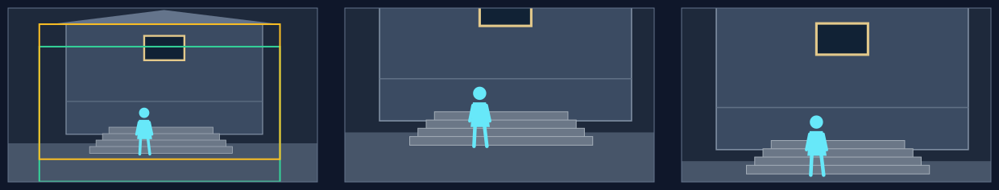

# 纵向平移：读出上下关系与高度

## 适用条件

人物与楼上窗口、城墙与城下、台阶上下或塔身与顶部之间，存在承担叙述的垂直关系。底图用一个统一视点画出相连结构；上下两端以及中间高度有足够分量。上下移动保留该图原有透视。

仅仅因为天空很空，不足以支持上移。内容若主要在同一水平线上，上下移会花时间离开重点；不能用它伪装机位升高、俯视变平视或越过屋檐。

## 选择理由

垂直路径让高度、层级、仰望或落差成为一段观看。需要保持尺度、沿上下联系依次阅读时，纵移能直接组织这份关系。向上或向下取决于先读哪一端；权力、期待或代价等含义由人物状态和具体场面支持。

## 典型应用场景

| 场景范围 | 常见内容 | 为什么选它／画面前提 |
|---|---|---|
| 建立高度或落差 | 城墙、建筑、桅杆、井壁、阶梯等上下延伸结构 | 沿结构读，比横移更直接地交代高度；上下部分和连接来自统一视点。 |
| 读上下位置中的人物关系 | 楼上与院下、台上与台下、坡顶与坡脚的呼应或阻隔 | 顺着人物的仰望、俯视或位置读两端；地位或情绪必须由场面支持，向上本身不等于权力。 |
| 从上部标志读到下部状态，或反过来 | 设施顶端与基座、上方信号与下方人群、人物与高处目标 | 观看顺序突出关联或逐步显露；注意对象要沿垂直方向分布，末态仍能解释两者为何相关。 |

这些是可迁移的用途范围。下方只完整演示其中一例，人物、地点与方向随当前内容重新设计。

## 本例实操

原创虚构例，旁白：“他站在台阶下，等着楼上的答复。”

**场面构思：** 已选人在阶下仰望高窗的瞬间；`entryFocus`为阶下等待的人，`landingFocus`为人、高窗与其间高度，`viewerChange`为体会上下距离中的等待。以下在联合设计落实这个任务。

### 构图与选择

1. **构场：** 站在庭院前侧看建筑，近处院地，中部人物与台阶，后方立面及高窗连续。人物约在x=0.44、y=0.57—0.84，高窗约在x=0.44—0.57、y=0.16—0.30。人在下方仰头，台阶和墙面给出距离。
2. **取景：** 入口读人物与向上姿态，并带到高窗的下部；向上移动，使高窗与两端高度更充分。末态仍留人物及台阶，目标是等待关系，不是忽然发现有一栋楼。
3. **选择：** 已定任务要读上下距离中的等待，当前布局适合沿立面向上。写`motion.type = traverse`，保住两端及中间联系；等待不等于被拒绝，按原语义保留含义。

### 取景参数与图例

本例选择`motion.speedRatio = 1.1`（110%），使用8秒、60fps的单图练习，无接镜余量；实际运动到末帧约7.983秒。下列是本例的`(x, y, width, height)`，不是推荐值。正式节目使用原工作单的真实预算。

| 起框 | 语义终框 | 程序返回的实际末框 |
|---|---|---|
| `(0.1, 0.22, 0.78, 0.78)` | `(0.1, 0, 0.78, 0.78)` | `(0.1, 0.091, 0.78, 0.78)` |

纵向可向上也可向下；下图只示向上，选择取决于本图的上下关系。

楼下的人、台阶与高处窗洞属于同一立面。沿上方读时，立面仍把两端连在一起，人物没有被裁掉后只剩天空。

**图例从左到右：** 完整源图及取景框 → 起始取景 → 实际末态。绿框为起框，黄框为实际末框；右格不是理论路线终点。

### 复核与衔接

4. **看实际框：** 窗洞可辨，人物头部、姿态与必要台阶在末态还存在，墙面有足够连续段建立高度。若底部丢掉了人，重排高度、人物位置或观察距离，再复测同类观看；不能靠“镜头仍在看人”的文字弥补。
5. **接缝：** 上镜若落在上方对象，新图可从相近视觉区域承接；也可以由当前等待者独立起镜。选方向仍先服从本图上下关系。

## 怎样迁移

从高处旗号读到下方队伍可以向下，塔、井、阶梯与桅杆也可。用近中远关系支撑立体场地，不把上中下画成三张独立小场景。
