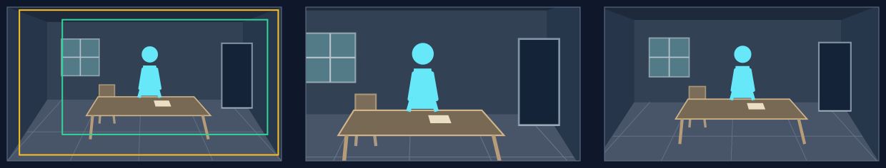

# 拉远：让主体的处境显出来

## 适用条件

入口的人或物已经足够清楚；扩大视野后，空处、他人、建筑、队列或行动范围会增加理解。完整源图已经画出这些空间，主体退小后仍能识别，新增区域有叙事作用。焦点可选画面任意位置的人、物或一组关系；拉远时框扩大，中心可同时向需要展开的环境偏移，焦点可保持屏幕位置，也可随构图调整到一侧。

“拉远”可以让本来部分可见的环境变得充分，也可以揭示初框之外的内容。后者须有真正藏得下的边缘区域；当前最大倍率有限，不能许诺从一只眼睛拉到整个广场。

## 选择理由

主体的意义来自它与周围的比例或关系时，拉远能让观众从局部认识处境。相比收紧主体，扩大取景更适合让周边共同参与表达；平移保持尺度，适合连接区域，而拉远同时改变主体与环境的比例。孤独、释然、受困、规模都可能由拉远表达，具体情绪来自空间里实际有什么。

## 典型应用场景

| 场景范围 | 常见内容 | 为什么选它／画面前提 |
|---|---|---|
| 从局部建立整体处境 | 从一个人或物，读到所在房间、院落、队列或现场分工 | 新增加的环境回答“他处于什么情况”；环境有具体信息，主体退小后仍可辨。 |
| 让人与环境的比例说话 | 孤身与空处、少数与众多、个体与建筑或自然环境 | 比例变化让孤立、规模或压力可感；含义来自实际空间关系，同一动作也能表达释然。 |
| 用周边新信息修正初印象 | 先看局部成果，再见周围代价；先看一人，再见陪伴或围困关系 | 多个方向逐渐加入信息，适合整体扩展；必要内容确实在初框外，并能在有限倍率内进入。 |

这些是可迁移的用途范围。下方只完整演示其中一例，人物、地点与方向随当前内容重新设计。

## 本例实操

原创虚构例，旁白：“谈话结束了，他还留在空下来的屋里。”

**场面构思：** 已选散场后独坐的瞬间；`entryFocus`为留下的人，`landingFocus`为人和空下来的房间，`viewerChange`为孤身停留的处境加深。以下在联合设计落实这个任务。

### 构图与选择

1. **完整场景：** 本例采用与[房间实例](../../examples/composition-room.md)相同的空间连接方法，另画谈话后独坐的场面：地板、桌椅、后墙、门窗相连。人物可见部分占原图高34%，对座、桌边空处和通往门的地板共同表达空落。
2. **入口与末态：** 先以较近框读人物不动的姿态，仍带一点对座；拉远让周围地板、家具间距、出口与他共同可读。本例让人物大致留在原屏幕区域，展开四周；其它构图可以随扩框移动中心，把更多空间交给某一侧的环境。
3. **选择与字段：** 比推近更能表达“留在空屋里”，比平移更能让人和空间的比例变化。沿用上述观看任务，写`motion.type = pull-out`，无中途点。

### 取景参数与图例

本例选择`motion.speedRatio = 1.1`（110%），使用8秒、60fps的单图练习，无接镜余量；实际运动到末帧约7.983秒。下列是本例的`(x, y, width, height)`，不是推荐值。正式节目使用原工作单的真实预算。

| 起框 | 语义终框 | 程序返回的实际末框 |
|---|---|---|
| `(0.2, 0.08, 0.75, 0.75)` | `(0, 0, 1, 1)` | `(0.0436, 0.0174, 0.9455, 0.9455)` |

本图只演示从桌前焦点展开；可从其它焦点起步，按要呈现的环境同时设计扩框与中心移动。

主体保持可辨，房间及对座逐渐获得分量。图中对座从一开始就部分可见，因此本例是**扩大环境关系**，不是“最后突然发现空椅子”。

**图例从左到右：** 完整源图及取景框 → 起始取景 → 实际末态。绿框为起框，黄框为实际末框；右格不是理论路线终点。

### 复核与衔接

4. **实际阅读：** 本例末态人物仍约占屏高36%，能辨认坐姿；以实际末框判断门、对座和空处的关系，不把尚未到达的整图边缘当成已经出现。若所需空处没有进入，重排主体与空处、修正同类取景，不能仅改写“已经看到”。
5. **与上下镜连接：** 若上一镜读的是动作细节，此处可把后果放回环境；若下一句立刻进入另一行动，拉远末态需在当前窗口内交代完处境。按两镜实际关系选择转场。

## 怎样迁移

焦点可以换成孤舟、门前的一组人或队列中的某一处，初框位置随之改变；扩大后框继续包含前框，中心无需固定。新增空间必须改变理解；纯粹增加空白可能只让主体变小。需要“后来才知道还有另一人”时，把另一人的必要辨认区域与起框、显露时刻逐一对应。
