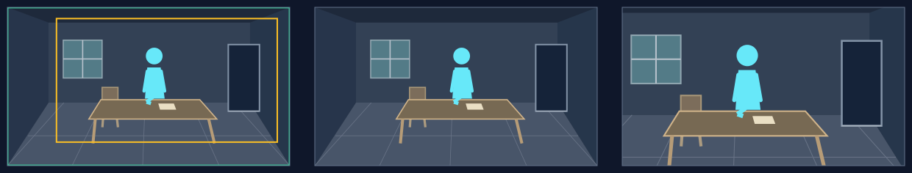

# 推近：让已经存在的重点获得分量

## 适用条件

当前观看需要读人物的迟疑、专注、压力，或一处已经可见的动作、痕迹。主体在入口就有可辨的大小；周围场所先给出处境，收紧后仍保留理解动作必需的人、物与联系。焦点可选画面任意位置的人、物或一组关系。推近时框逐渐缩小，中心可以同时向所选焦点偏移；焦点也可以留在适当的边侧，无须移到屏幕正中。

若主要信息来自人物与广大环境的比例，收紧可能损失表达；若要读的东西在原图里本来就太小，有限缩放也救不回来。先把源图中的主体分量和观察距离设计合适。

## 选择理由

推近让所选重点更集中，外围竞争逐步减少。可以持续看同一主体，也可以从已有多个对象中收紧到其中一处；镜框中心按焦点位置一起调整。相对于拉远，它把分量交给主体本身。重点可以是人、物、人与物的动作接点，不必默认推向脸。靠近是否形成压力、亲近或发现，由场面与旁白决定。

## 典型应用场景

| 场景范围 | 常见内容 | 为什么选它／画面前提 |
|---|---|---|
| 人物状态逐渐加重 | 等待、犹豫、决断、专注等，变化主要在观众对同一人物的体会 | 靠近持续增加人物分量；表情或姿态在入口就能读到，环境仍交代他为何如此。 |
| 动作接点或物件细节成为关键 | 手与物的接触、器物上的痕迹、已经可见的线索 | 收紧能让关键联系更清楚；物件原本要够大，末框保留理解动作必需的上下文。 |
| 从群体或繁杂现场选出一个重点 | 众人中的一个反应、多个工位中的关键一处、阵列中的某个位置 | 减少外围竞争，使已有重点突出；完整现场仍成立，不能把缩放当成身份介绍。 |

这些是可迁移的用途范围。下方只完整演示其中一例，人物、地点与方向随当前内容重新设计。

## 本例实操

原创虚构例，旁白：“信就在面前，他的手却停在桌边。”

**场面构思：** 已选桌前停手的瞬间；`entryFocus`为桌前人及停住的手，`landingFocus`为同一动作，`viewerChange`为迟疑感加深。以下在联合设计落实这个任务。

### 构图与选择

1. **先构场：** 观察者位于房间前侧、平视略偏侧。地板通到后墙，桌椅落在房内；左侧对座、右后门洞、窗光共同给人物位置。人物可见部分约占原图高34%，头、手与信都在中部，门与对座退为次要。完整字段见[房间实例](../../examples/composition-room.md)。
2. **再形成取景：** 入口读清坐在桌前的人与停手；末态更集中于人、手、信，保住桌面和对座的必要部分。人物位于原图约x=0.52，定向中心随框收紧，避免把脸挤向边缘。
3. **作出选择：** 此句要让停手的迟疑更可感；推近增加人、手、信这一组关系的分量，环境仍提供处境，符合已定的观看任务。
4. **落实运动：** `motion.type = push-in`，两端见下表，`routeWaypoints = []`。语义终点就是自然终界，普通入口补齐安全终界；沿用当前的观看任务、来源与禁造项。

### 取景参数与图例

本例选择`motion.speedRatio = 1.1`（110%），使用8秒、60fps的单图练习，无接镜余量；实际运动到末帧约7.983秒。下列是本例的`(x, y, width, height)`，不是推荐值。正式节目使用原工作单的真实预算。

| 起框 | 语义终框 | 程序返回的实际末框 |
|---|---|---|
| `(0, 0, 1, 1)` | `(0.2, 0.08, 0.75, 0.75)` | `(0.1729, 0.0692, 0.7839, 0.7839)` |

本图只演示桌前焦点；其它位置同样可选，同时设计收紧幅度与中心偏移。

简图保留完整房间。人物及停住的手变大，仍能读到桌面与对座；不会从室内全景突然变成手部特写。

**图例从左到右：** 完整源图及取景框 → 起始取景 → 实际末态。绿框为起框，黄框为实际末框；右格不是理论路线终点。

### 复核与衔接

5. **按实际框读画：** 核对头、手、信能否一起辨认，对座和房内关系是否仍成立。末态人物约由34%增至43.4%屏高，足以加强姿态，不承诺看清原图没有的表情细节。若手被桌沿挡住，先改冻结场面的姿态与遮挡；若路线不足，按[失败修复](../design-method.md#测量不足时修什么)联合调整构图、取景与路线，必要时改用能承载当前表达的运动方式。
6. **接到上下镜：** 上一镜若刚交代环境，此处靠近可继续集中；上一镜已同样贴近时，比较此处动作是否带来新的观看内容。转场仍根据具体两镜选择。

## 怎样迁移

目标在左、右、上、下或斜向任一位置时，都可按构图定向推近，每一步框仍严格内含；需要保留两个人的动作接点，就把接点作为一组主体，不机械追单张脸。完整场景与合法框中若无法同时保住必需关系，应先调整调度和观察距离。
