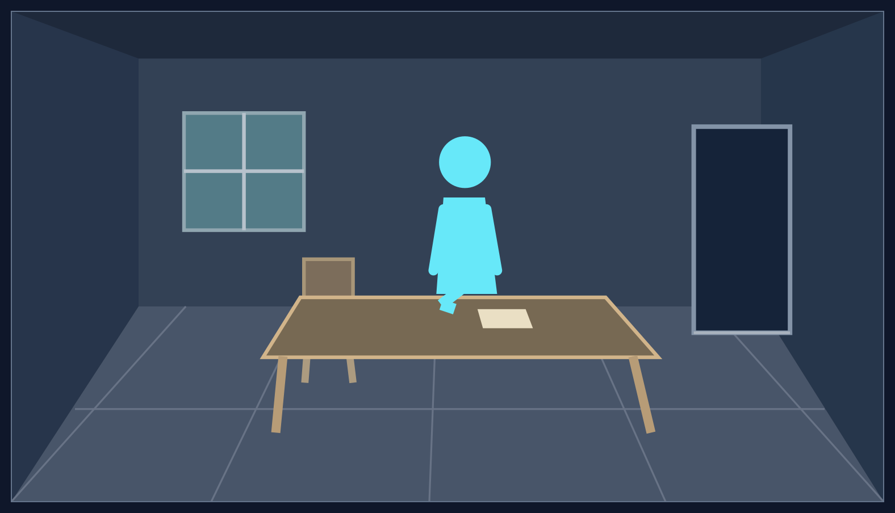
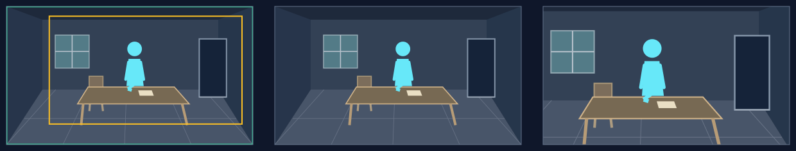
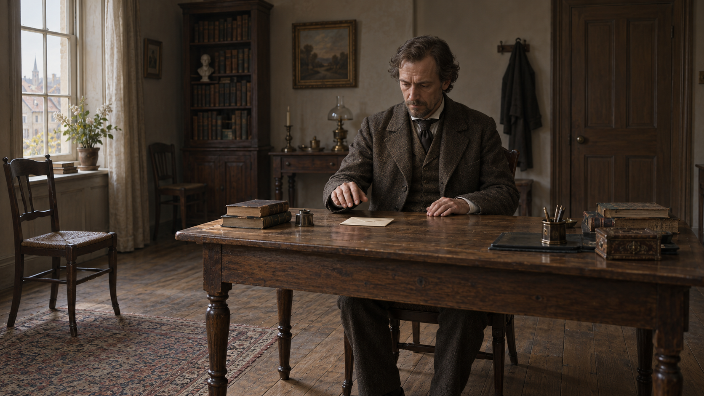

# 用动作间隙表现迟疑

原创虚构教学。迁移推导，人物、地点、比例及画风不作生产依据。

### 已选语义与可见安排

旁白：“信就在面前，他的手却停在桌边。”

构思已选“信在面前、手停在桌边”的瞬间，观看任务是体会迟疑。联合设计用手与信的间隙、身体趋近而手停住的姿态兑现这个任务；房间与空座提供处境。

### 完整场景与主次

**把观察位置、动作与房间范围一起确定。** 观察者站在房间前侧，隔着近处地板和桌前空处略偏侧看人物。距离既能容下桌椅、左侧空座和右后门洞，也让停手与信的间隙可辨；桌沿压低到手下，避免挡住动作。地板通向桌椅和后墙，家具脚落地，桌边到门洞有通路，靠距离、连接与遮挡形成层次。若手信关系太小，就共同调整距离、桌面角度和人物调度，而非只把“34%”改大。

**主体分量与场景完整同时成立。** 可见人物约占源图高34%；空座、门洞较安静，房间不会让人物缩成一个点。桌前人既可来自一幅完整场所，也可在其中得到较近的取景。

**图例读法：** 浅蓝人物与停住的手是主位，桌上的浅色信与手留有间隙；左侧空座、右后门洞提供处境。简图只解释空间；实际表情、衣装、身份和画风由当前正式内容与Visual形成。

### 写入完整场面

构思已经形成`purpose / attentionPlan`；联合设计把以下原文写入`sceneDescription`。运动命令不交给生图，统一画风仍由Visual给出。

> 从房间前侧隔着地板和桌前空处，平视略偏侧看桌前人、左侧对座及后墙门窗，距离能看清脸部朝向、停手和信。近处地板接向中部桌椅，家具脚落地，与后墙有真实间距；桌边有连续通路通向右后门洞，左窗和门洞各有空间。桌前人在完整16:9画面x约0.52，头到可见腰部从y0.25至0.59，约占画高34%。他面对桌上的信，身体微向前，手停在桌边，尚未触到平放在前方的信；手与信同处x0.46—0.62、y0.56—0.65，间隙清楚。左侧空椅朝向人物，椅背不遮手。人、停手与信是主位，空对座和周围房间较安静。傍晚窗光落在人和桌面，墙面及门洞较暗，人物轮廓和动作仍可辨。

`acceptanceCriteria`保留三个可见要求：人、手、信同时清楚且有间隔；桌椅与地板、门窗及后墙相连；人物保持所需分量，对座可辨但次要。实际生产的`sourceRefs / mustNotInvent`来自当前正式输入；本虚构练习不以任何真实史事作依据。

### 形成这一次观看

本句要读迟疑，因此采用[推近卡](../camera/methods/push-in.md)的入口、实际末态和完整操作：先看桌前人与停手，再使同一动作获得分量。入口是完整源图，理论终框在右侧略偏内；按卡中的无接镜余量单图练习，以110%运行约8秒，实际末框宽约0.7839，人物屏幕占高由约34%增加到约43.4%。房间、桌面与对座的必要关系仍在。[A/B联合练习](joint-reading.md)使用实际成图及所选转场窗口另算，不能直接搬用这幅简图的末态。

**图例从左到右：** 完整源图及取景框 → 起始取景 → 110%恒速运行约8秒的实际末态。绿框为起框，黄框为实际末框；右格不是理论路线终点。

联合设计应保有相连场地，不能指望调框补出未画的房间。生成后的表达、取景及图片偏差按[落镜方法](../camera/realization-method.md)处理，不在案例中另设返图标准。当前合法缩放的最大连续行程仍有系统上限，达到上限却不够时按[真实失败归属](../camera/design-method.md#测量不足时修什么)处理，不把程序限制无限推给构图。

### 同一内容的三种拍法

仍用同一句“信就在面前，他的手却停在桌边”。比较时保留事实、已选瞬间和“体会迟迟不接的犹豫”这一任务；每种拍法都要保住人、手、信的关系，并为它安排合适的构图。不能分别给三种运动换成迟疑、孤独、交代方位三个目标，再把它们称为同题比较。

| 竞争拍法 | 具体构图与观看所得 | 对这次任务的代价与选择 |
|---|---|---|
| 定向推近人、手、信 | 三者先已同处可读区域，收紧使停手和间隙获得更大分量，对座仍提供处境 | 最直接加强犹豫，选用；源图保持完整房间，推近不是另生成手部特写。 |
| 从人、手、信拉开到桌前空间 | 初框先使停手可读，扩框仍保留动作，同时展开未完成交接的桌面与对座 | 仍可表现迟疑，但本例周边没有增加理解所需的信息，手信间隙反而变小，故不选。若环境确实补足迟疑的处境，才有更强竞争力。 |
| 沿桌面从信移向停手与身体 | 让信、手和身体朝向构成相连的观看路线，保持三者可辨，以主次变化读到迟迟未接 | 可以成立；本例三者在入口已共同清楚，进一步联系的收益较小，选收紧这组动作。换成“双方递而不接”的任务和调度时，平移保住双方反应可能更合适。 |

这个比较发生在联合构思中，选定后仍只交原字段，不要求逐图填写三方案。表中取舍依据本例的具体构图，不宣布推近普遍更好。若改为体会人与空屋的处境，那是构思表达目标改变，应重新形成观看任务；它不是联合设计为另一种运动补写的理由。生成后原镜头需要的手信关系看不清时，先按实图调框；确实无法完成原镜头才定点修图，命名为“情绪推近”不能证明效果。

反过来看，同一推近也没有固定情绪：靠近相互回应的姿态可以使亲近更可感，靠近退缩的姿态和仍在迫近的一方则可能加强压力；冻结场面、人物关系和旁白不同，意义才不同。当前静图不能把“仍在迫近”的动作演成持续前进，只能呈现已选瞬间及其关系。迁移的是推导方式，人物、事件、坐标和运动名称都不是答案。

需要辨清接镜显露与持续运镜时，读[连续接镜实操](joint-reading.md)；构图与运动的数字只适合本例。

### 在实图中比较

[有声实片](viewing/README.md)为同一迟疑任务补了完整房间图，推近、平移、拉远各保住脸、两只手和信。实图中的人物比上方简图更大，不能照搬34%或旧坐标；实际镜框由`viewing/data.mjs`按图落实，继续调用正式相机。

推近使手信间隙在这句话的后半段更有分量；平移虽保住三者，主要改变位置，没有新关系进入；拉远让空座和房间增多，但这一句需要读的停手变小。因此本实图选推近。三片不证明推近普遍优于其它运动，也没有把静止的手演成接信动作。生产中只为落实原镜头查看手、信与间隙的位置和取景，不另开肢体或整幅画面审查。

