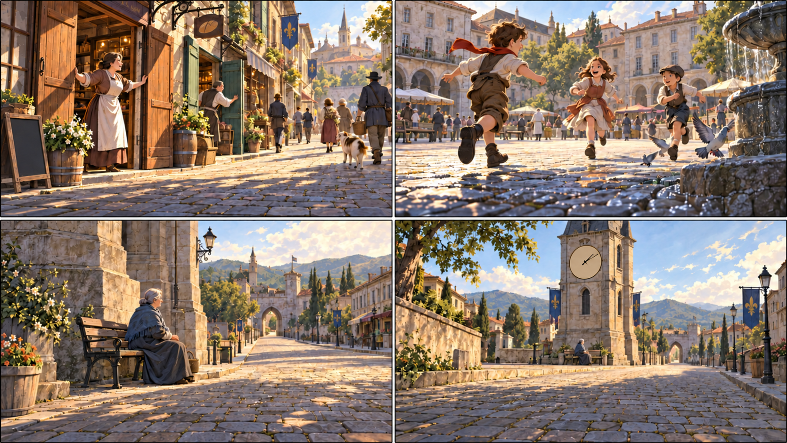
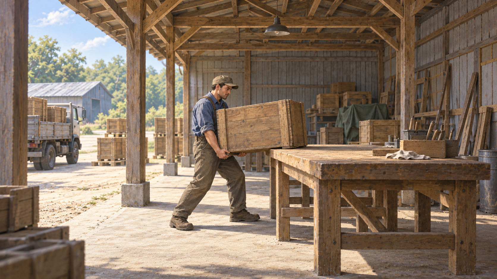

# 从故事中选择关键帧

原创虚构教学。迁移推导，人物、地点、比例及画风不作生产依据。

原创旁白：“停战的消息传来了。昨天还紧闭的店门开了，孩子重新跑过广场。可钟楼下，仍有人望着城外的路，等着没回来的人。”

先理解整段：公共生活恢复了，个人的等待却还没有结束。若所有画面都表现欢庆，就会漏掉最后的余味；若从头到尾都画忧伤，又会失去生活正在恢复的事实。本练习先让恢复变得具体，再让等待进入观众的视野，使两种处境在同一座城里并存。

**第1格选店门打开的一刻。** 人撑开门扇、迈向街巷，门后的活动与街上的回应让“恢复生活”成为眼前正在发生的事。沿街的光线、门口到广场的连接让整座城市成为经历的一部分，重点不限于一双开门的手。声音已经交代停战，画面从它给日常带来的变化进入；再画发布消息的人，会停在通知行为。

**第2格选孩子奔跑中回望同伴的一刻。** 第一格建立“生活重新开始”，这一格让人感到生活的舒展。奔跑的姿态、同伴的回应与开阔广场，使恢复变得鲜活；若只换一群人继续开门，就没有同样的推进。联合设计选择较低的观察位置，把奔跑的力量和身处的世界同时画清；该位置服务这次感受，不是动作画面的固定机位。

**第3格留在钟楼下的等待。** 前面的热闹使这一刻的安静更有分量。人没有新动作，空路上也没有新事件；等待者的姿态、目光与延伸出城的道路，共同让“尚未归来”具体可感。观众此时会发现：生活已经恢复，有些人的等待却没有结束。无须额外画出战死、伤者或悲痛面孔。

**第4格是第3格的备选，不接在它后面。** 保留同一地点、人物和时刻，把钟楼与空路放大，等待者缩入城镇的尺度中。它更强调时间与生活继续，个体感受较远。本段希望最后停在人身上，因此选择第3格；若整段重在漫长岁月，第4格可以更合适。实际取舍由构思明确表达重点，联合设计形成相应构图，不按“情绪必用近景”决定。

**这三格为什么这样排列。** 店门打开，建立变化；孩子奔跑，让变化可感；最后的等待，使前面的恢复显出另一面。结尾的意味来自前面已经建立的生活，不只靠一张忧伤的人像。若先画等待，最后落在孩子奔跑，整段就更容易收在生活复起的方向。两种顺序各有作用，本例按旁白选择最后停在等待者身上，让恢复与未归并存；换序不是脱离当前口播重排画面的许可。

**换题材时沿用推导。** 从当前正文中找出值得建立、发展和重新理解的内容，再选择相应画面，不套“热闹之后一定接悲伤”。有些段落适合持续推进，有些适合对照，有些只需留住一个值得体会的场面。

这段串读只示范选择理由与前后感受，不预定Beat、图数、A/B或运镜；正式组织仍按当前导演任务、真实Cue和原共读方法。`purpose`交选定瞬间及作用，联合设计把主体、场所、状态和构图写入`sceneDescription`，再联合设计观看。备选比较属于构思，不要求逐图交多个方案。

按左上、右上、左下、右下阅读，第四格只作结尾备选。图内不放文字，说明留在正文；四格拼排仅用于教学，每格各是一幅完整场景。正式生产交独立单幅；本图不提供节目画风、史实或实图运镜证据。

## 把连续动作转成一张静图

以下是另一段原创虚构练习。假定当前材料明确支持工人正把重木箱搬到工作台上，本页重在让人感到搬放时的重量，不要求展示已经放稳的结果。

“工人吃力地搬箱子”只交了动作名和感受。视频可展开抓稳、抬起、搬近、落放，静图则先选其中值得观察的一刻。本例选**箱沿刚搭上台边、另一端仍由双手托住**：台面已经承接一部分重量，人还没有松手，身体与箱的位置共同让负担可见。若箱已平放、双手离开，重点就变成搬完后的状态；只画咬牙或汗滴，重量仍缺少具体支撑。

| 写法 | 本例的取舍 |
|---|---|
| 工人抓住箱子，抬起来，走到台前，再放下 | 串了多个时刻，尚未选出这一张图画什么 |
| 工人满脸吃力，旁边有木箱和工作台 | 人、箱、台虽齐，身体怎样承担重量仍不清楚 |
| 箱沿搭住台边，另一端仍在双手中；工人屈膝、前脚撑稳，身体贴近箱侧 | 同一时刻的接触、承托与姿态使重量可读，适合本页任务 |

这个选择写入`purpose`：“装卸棚工作台前，工人托着近端，箱沿刚搭住台边；取这一瞬间，让重量落在可见的支撑关系上。”联合构图后，`sceneDescription`可以这样落笔：

> 从通道侧方望向敞开的装卸棚，工人与木工作台位于棚内中景；棚口、连到台前的搬运通路、棚柱与后方堆货共同交代作业空间，工作台的台面和支腿清楚可见。工人站在台前，双脚前后分开、双膝微屈，前脚撑稳；重木箱贴近腰腹，远侧底沿搭在台边，近侧底部仍由双手托住，双肘收在身侧。侧向取景使箱沿与台面的接触、双手承托及站姿清楚可辨。

本图由自带生图生成。人物与工作台放在完整作业场所中，入口、通路和堆货让搬运发生在相连的空间里。侧向取景、手臂轮廓、箱底与台边的接触共同表现承重，远侧前臂保留自然遮挡。动作写得具体，要落实到这些关系；人物占多大，则与场所及观看重点一起安排。本图示范场面与动作，节目画风依当前Visual，也不自动作为生图参考。

这里的脚步、屈膝与贴身承托服务当前搬放姿态；不是每个动作都套这组身体形状。换成推门，应重新找手与门沿、门轴、站位的作用关系；换成等待，则可能只需保留姿态、目光和空处。人物外貌、箱体材质等只写当前场面需要的辨认信息，画风继续由当前Visual提供。

静图的轻重、急缓来自所选姿态、方向、间距和痕迹；“缓缓抬起”“停顿半秒”本身不会让画中人物活动。运镜可以带观众靠近支撑关系，不能把未画出的搬运过程补出来；这一瞬间也不强制拆成A/B。以上只示范静态选帧与描述，不改原图数、Cue、接镜或参考素材用法。
