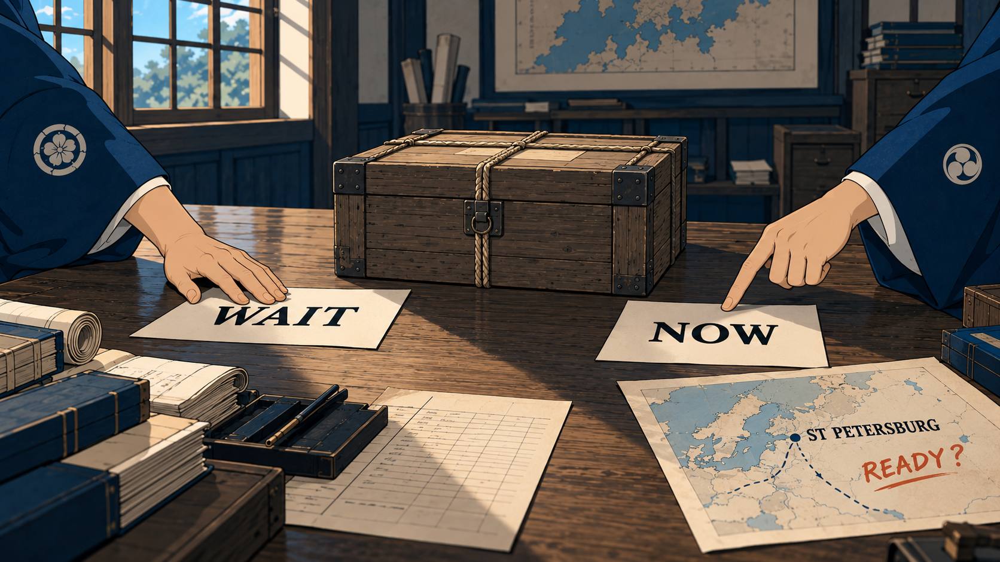
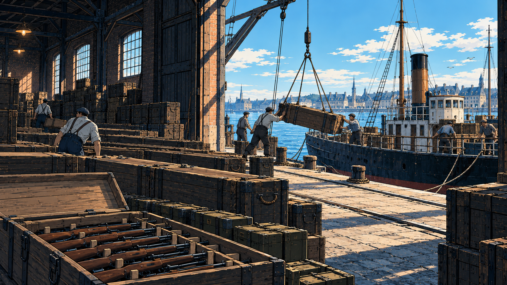
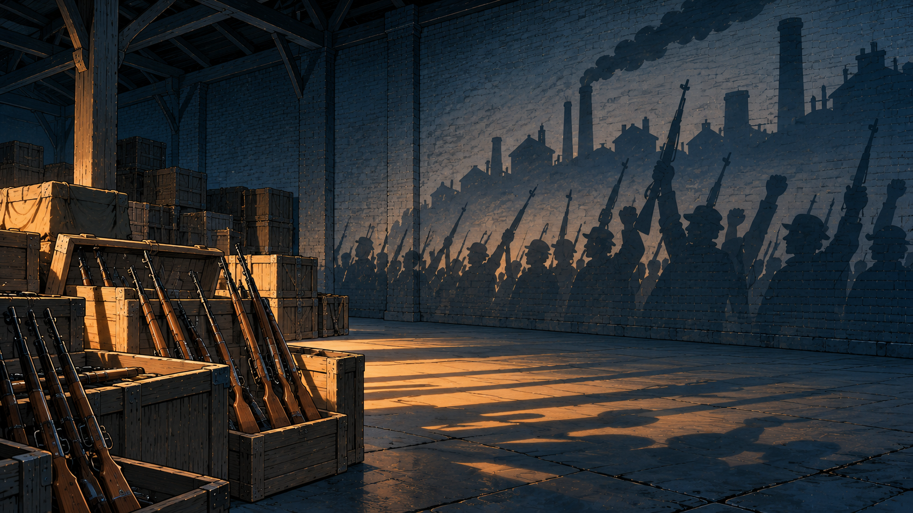
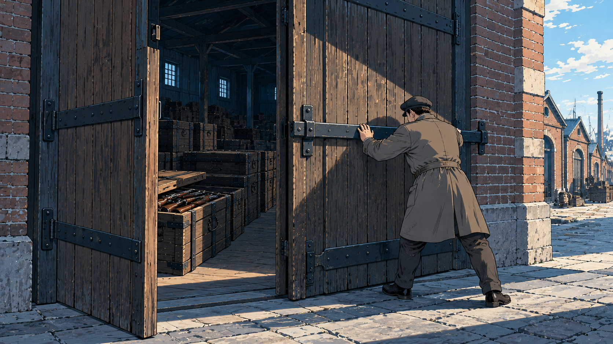
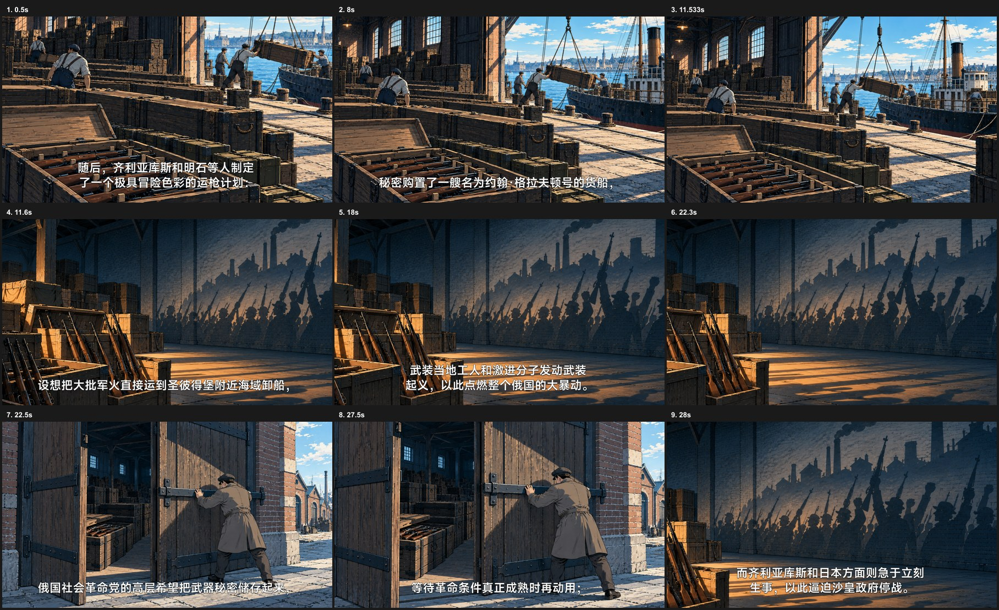
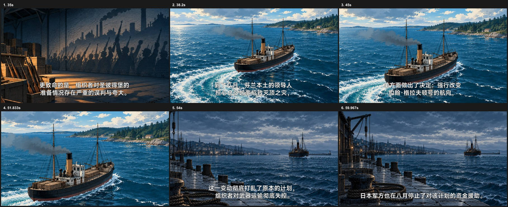

# 从运枪文字到一段观看经历

本教材用于理解[场面选择](../../references/scene-selection-method.md#把文字改编成画面)中的构思推导。它来自一次独立改编验证：沿用《日俄战争》EP16原口播、字幕、时长和明治画风参考，五张完整源图组成六个镜头，60.033秒。用户观看后确认改善明显。教材保留原图、改编图、实际取景和未解决部分，不把整段视为无缺陷范本。

图片只供学习取舍，不能作为当前节目的事实、画风或自动生图参考；这里的船型、仓库、岸线和关门动作均有代表性演绎成分。文字含义仍须从当前工作单独立理解，图数、对象、动作、意象和镜头都不能照搬。

下文先理解整段，再比较各图的表达。表中的六个原样片窗口不是现行Beat切分建议；当前切点按导演的字幕语义与口播节奏确定，作者在获准范围内落实画面与持续运镜。

## 先把这段话理解成一件事

这段原文依次讲：筹划者购买数千支步枪、弹药和货船，设想运到圣彼得堡附近、发动起义；另一方希望保存武器、等待条件成熟，筹划者却急于行动，并夸大当地准备情况；随后芬兰方面改变航向，组织者失去掌握，日本军方停止资助。

“购置—计划—分歧—误判—失控”概括正确，却还没有给出值得观看的内容。再往里理解：这里已有一批有规模的武器和运输工具；不同人把它看成不同的未来；买到物资并不等于具备动员条件；当船的去向由别人决定，原筹划者便不再掌握这项行动。

因此，这版选择跟随武器与船展开观看。开头让物质力量可感，中段看不同使用意愿，后段让航向和距离接手。它没有虚构筹划者之间的新对话，也没有逐句安排一个人解释自己的立场。这是本段适合的观察线索，人物经历、生活细节或其它视角在别的内容中可能更合适。

导演可将物质规模、不同意愿、航向与掌握关系交到原观看职责；作者再决定现场、意象和镜头。不能反过来要求所有导演写“先仓库、再影子、最后空码头”。

## 第一反应为什么不够

原分歧画面如下：

两只手、木箱、地图与三种文字分别对应等待、立即行动和准备疑问。它能标明意见，缺点在于事情的具体世界没有展开：看不见武器被寄望承担的力量，也难以体会保存与立刻动用的差别。换名字、换纸面文字，就容易用于许多无关争论。增加精致笔触或更有力的手势，仍然是在精修同一个薄弱想法。

这不证明纸张、地图和近景不可用。若事情本身发生在一封信抵达、一个人读懂消息的瞬间，它们就可能是最准确的选择。此处继续推敲，是因为原文值得看的内容远不止“有不同意见”。

## 从内容推到画面

### 武器与船：把物质规模展开

“购买步枪和船”最容易画成筹划者、购买文件及船的图纸。继续理解就会发现，武器成为行动条件，要经过存放、搬运、装船和航程。于是选择仓库到装货船相连的现场，让箱阵产生规模，搬运者和吊具使重量可感，门外船体使去向具体。

这幅图的环境参与内容：去掉箱阵，体量会减弱；切断仓库与船的联系，就只剩互不相干的物件。入口以枪箱取得主位，拉开后船和装运空间获得分量。源图本身已有完整联系，相机才有东西可展开；不是先画人脸，再指望拉远补出环境。

装运动作是代表性演绎，具体购买者、数量及船名由原口播说明；它不证明某次装船现场，也不提前画成武器已经运抵、发给工人。

### 期待与保存：同一批力量的不同用途

筹划者寄望枪械带来起义。直接画持枪群众，会把愿望变成已经发生的事件；只画“起义计划”纸条，又回到命名。此版把枪械作为实物，把大规模人群留在违反物理规律的投影里：枪械仿佛能投出一场城市动员。意象与本段所期待的作用有关，不是任意加一个象征“希望”的物件。

原口播说明这只是设想，影子表达寄望的规模；具体地理仍由声音承担。镜头从枪械一侧向人潮移动，改变关注分量；人影在入口已经部分可见，不能将整条路线宣称为从无到有的揭示。

另一方希望等待成熟条件。选择门内军火与关门姿态，让“暂不动用”成为一种有重量的意愿：可用的力量仍在，人的动作正在收住它。厚重门扇、箱列与接触处共同承担含义，不需要再贴“WAIT”。

这幅源图并未复原一次已核实的仓储命令。合理演绎使保存意愿可感，不能据此新增“某人实际封存了这批武器”的史实。人物在这里必要，因为他的身体动作参与表达；不因反对泛泛肖像而把人一概删掉。

### 改航与失控：从支配物资走到失去掌握

口播转到航向被改变，观看也从期待与分歧进入实际运输。货船、弧形尾流和岸线共同形成方向变化。尾流是静态痕迹，相机并没有让船真的转弯；芬兰西海岸的名称、谁做决定与动机由声音交代。岸线是代表性环境，不承担精确路线图功能，也不补画卸货、接应、事故或战斗。

“失控”若只配筹划者惊讶的脸，容易变成通用反应。此版返回近岸观察位置，用空泊位、松下的缆绳、闲置吊具与远船的间隔，回应开头仍能组织装运的场面。事情曾可触及，如今远在水上；空间与气氛接住失去掌握的感受。它不独自解释政治决策或资助关系，停止资助的事实仍由旁白说明。

空码头不是“失控”的通用符号。本例此前已建立船与装运，重见近岸才有分量；换到另一段内容，可能只会读成普通离港。

### 光色也会把意思带偏

上图已有空泊位、远船与距离，但金色落日、船后的亮光和水面反光容易把它读成浪漫出航。修正后保留空间构思，换成冷灰天光，让空落与疏离更贴近这段旁白。这里修的是已选意味的呈现，没有另换成沉船或灾难来加强情绪。

冷色也不是失败或悲伤的固定配方。应连着当前旁白和前后画面看实际感受，不能靠“冷灰、孤独、压抑”等提示词证明效果成立。

## 没有被解决的误判

第二张影子图在本片出现两次。第一次承接起义设想；第二次先承接急于行动，再拉开到枪械、空地与投影，试图让观众读出准备被误判与夸大。

但第二次没有足够强的新视觉依据。枪械与投影依然支持期待，空地也可能只是仓库地面；观众主要从旁白得知“准备不充分”。因此，本例不能推出“同一意象反向运镜，就能揭示误判”的方法。重复图、换取景、改`purpose`都不能代替确实发生的观看变化。

这也不要求图像脱离旁白独自证明史实。问题在于这次设计曾承诺一个较强的揭示，实际只形成较弱的反差。再改编时须从原文中寻找更贴切的表现；若没有足够事实支持具体准备现场，就保留不确定性，不能补造无人响应的会场、空荡的革命组织或失败起义来交差。现有图在“期待”部分的作用仍然成立，不因难点未解而否定全部构思。

## 完整源图进入实际镜头

下面是同一正式全画幅相机与渲染链输出的15个取样帧，左上角为片内秒数；不是独立裁剪后冒充运镜。与上面的完整源图配对查看，才能分清源图构思和实际呈现。

| 片内窗口 | 实际组织与可观察的限度 |
|---|---|
| 0—11.57秒 | 从枪箱拉开到装运空间，船取得更大分量；相机没有创造搬运动作。 |
| 11.57—22.31秒 | 枪械与人潮投影之间横移，期待的规模可感；不是实际起义。 |
| 22.31—27.935秒 | 收存动作、门内武器与门扇共同呈现保存意愿；不证明已经实际封存。 |
| 27.935—38.171秒 | 再看同一影子图并拉开，承接急于行动，但“误判”的视觉揭示不足。 |
| 38.171—51.847秒 | 船、尾流与岸线建立改航；后段推近后尾流减少，关注转向船与海岸。 |
| 51.847—60.033秒 | 近岸空位与远船持续同看，收束到距离与空落；资助事实由旁白承担。 |

取样能核对具体可见内容，不能代替连续观看的全部节奏判断。这段样片支持物质规模、意愿、方向与处境的可见改善；一个已获认可的片段不证明所有新题目都能稳定迁移。

## 在下一次创作中怎样用

沿原联合设计，从当前内容重新选择世界中的观察线索，写入现有`purpose / sceneDescription / attentionPlan`；整段发展由各图共同承担，事实与来源仍由本单限定。遇到泛泛构思时回看这里如何从“记录事情的信息”走进事情本身；遇到意象或气氛过度自信时，回看误判镜头和暖色初稿。

本例没有给后续生产新增画数、景别比例、必用意象或固定推导答卷。现有场面、构图、相机和实图落实方法继续拥有具体执行；案例只帮助作者理解选择及其代价。
