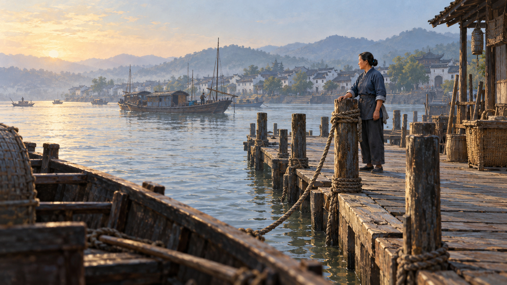
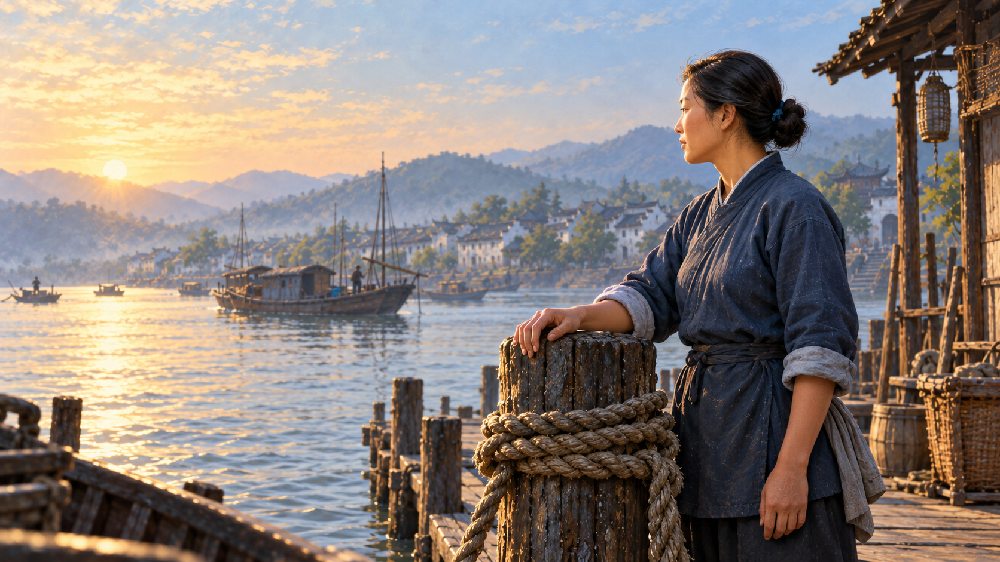

# 同一渡口的景别与层次

这组三张原创虚构图比较不同取景下的主次与清晰范围，不是历史来源或节目素材。三图分别重绘，不是同一源图的运镜结果，也不作为生产源图覆盖范围的示范；没有规定先远后近或同时使用三种景别。生产按[构图方法](../references/picture-construction-method.md#3-在同一场面中联合安排整体局部和路线)先提供完整场景，再用实际镜框组织观看。

## 远景：人与渡口

近处船舷切入画面，木桩与栈道把视线带向人物，河船与对岸继续拉开距离。人物没有占满画面，仍因位置、衣色与侧光从环境中分离。此时重点是她在何处等候，以及人与水面、渡船的关系；手指细节不是这张图的任务。

空间感来自遮挡、相对大小、透视与远处减弱的对比，不靠把背景全部模糊。若后续运镜一直裁向脸，最后丢掉渡口关系，就改变了这张图原本的表达。

## 中景：神态与姿态共同表达

观察位置靠近后，脸、搭在木桩上的手和系船绳共同可读，左侧保留视线所向的河面。主体、手与木桩处于主要清晰范围；远船和对岸柔化，仍能辨认环境。原来由空间规模承担的含义，现在更多落到人的等候姿态。

这张中景示意经过独立重绘，不能据此认定同一源图运镜能达到这种变化。最终取景要一起保住神态和手的动作，不能只让脸越来越大。

## 近景：接触处值得停留

脸和全身都不在图内，手与木头的接触、绳索质地成为观看内容，渡船留在柔化的背景里。清晰范围集中在手和桩面，邻近绳索仍可辨。这只示意近取景怎样强调接触细节；生产源图仍须保留本场景的必要内容、空间联系与实际路线，不能用这张局部示意替代。

静止的手可让旁白赋予等候意味；它不能单独证明人物已经松绳、决定离开或改变心意。最终镜头需要读这层接触时，手、桩面与绳索须已在完整源图和实际取景中清楚存在。

## 把选择交给当前内容

先确定需要看清的细节、关系和观看路线，再联合设计完整源图与最终取景。不能把三幅独立重绘的图当成一条运镜路线，或承诺有限缩放能把渡口全景变成手部特写。远景不天然优于近景，虚化也不是质量指标；完整场景不等于强凑全身、宽阔环境或固定三层景物。

三图均由自带`image_gen`生成；[提示词与参考关系](shot-depth/prompts.json)保留真实创作输入，不作为现行生产提示词。图例帮助理解取景效果，不提供固定构图、占比或运镜坐标。静图运镜通过同图起止裁切组织观看，参见[Apple的Ken Burns说明](https://support.apple.com/en-in/guide/imovie/movc6e02f503/mac)；本项目的尺度与时窗仍按原相机合同。
