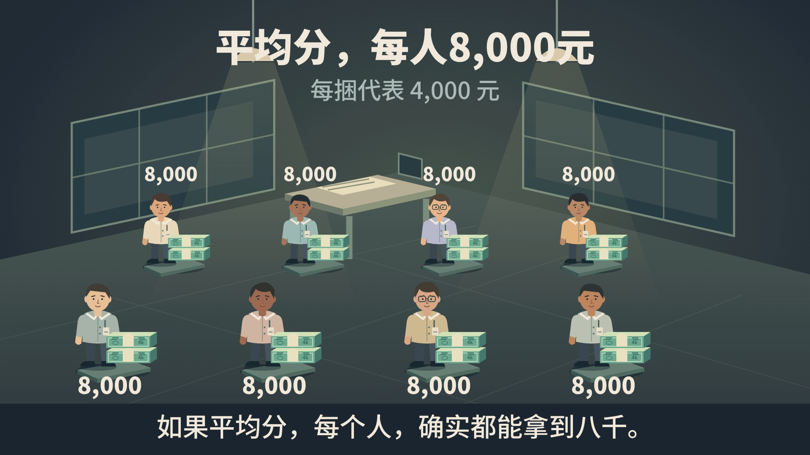

# 平均工资，藏住了谁？

成品视频不随仓库分发。本例保留教学源码、图件和时序；需要动态预览时，沿本例已有构建入口在本机生成。配套旁白仅为同长度静音占位，构建程序优先读取本机保留的原声。已有完整原片保留在本机的local-media/private-assets/对应路径。

原研究作品（仅本机保留） · [场景与动画](research-scene.js) · [场景构建](research-build.mjs)

已有认可的独立研究作品，约48秒，1920×1080、30fps，保留原旁白与字幕布局。

视觉构思从工资报告进入八个人的处境：同一笔工资改变分配，筹码再成为收入阶梯，人物随之重排，最后显示中位数。办公室、人物、筹码、文字与镜头共同组成这段发展。

## 镜头、动作与转形怎样接成一段

连着看下面各段，再查`research-scene.js`对应实现。这里的手艺不只用于工资或人物题：同一个依据可以先承载处境，再承载过程，最后成为比较；取景和动作各有时间，不必一起开始、一起结束。

| 原片时间 | 实际怎样编排 | 对应实现 |
|---|---|---|
| 约0—6秒 | 报告先落到视野中央，印章短促落下；随后报告缩小、移向侧上方，办公室和八个人在它后面展开。原先的大主角退成参照，新的观察接过面积。 | `paint`的`report / stamp / room / stations`，约113—128行；这里的办公室不是下一张卡片 |
| 约15.5—25秒 | “换一种分法”时镜头先靠近转钱处；七束钱按各自来源依次出发，飞行相互重叠，接收者的堆叠持续增长。转移结束后镜头退回共同尺度，原总额和新的分配同时可查。 | `cameraPush`约93—98行；`cash`约156—171行。单束飞行1.35秒，出发间隔0.29秒，所以不是所有钱一起滑到终点 |
| 约27.8—31秒 | 人物从办公室两排重组成一排；钱束稍后开始变厚、变色、褪去印刷，接成收入阶梯。环境退出，尺度随后出现。人的重排、物件转形和镜头承接相互重叠，形变本身带出新的比较。 | `assembly / morph`约89—103行；`groupAt`及人物约127—154行，钱束转形约173—184行；两种进度不相同 |
| 约34—40秒 | 沿已经形成的队列找到中间两个人，人物标记先取得注意，中位数读数后出现；前面的收入差距继续作比较依据。 | `medianPush / selected / medianBadge`约92—110行及人物选中态 |
| 约40.9秒到结束 | 队列和阶梯缩成下方参照，较大的“7/8”和“4,000”接住结论，静留供确认。结尾从已经发生的分配中形成，并未再摆一遍开头。 | `finale / zoom / panY / finalType`约91—112行 |

看片时留意每次画面把注意交给了谁，再用代码找出它的时间、路径和坐标承接；不要只借到同批对象或相同数量，就以为迁移了整段编排。表中秒数与速度只解释此片，不是当前作品的配额或预设。该片也有长停驻和下述遮脸局限，参考的是实际有效的手艺，不把它的每个选择当成标准。

## 造型与动作的完整帧

下面是从原`research.mp4`取出的1920×1080完整帧，时刻均以该片开始为零点。它们供观察完成画面及转换中的实际状态；连续节奏仍看片中相应片段。

**13.0秒，整体场面。** 人物、脚下承托、地面、窗、桌与灯光共同形成空间，前后两排取得不同分量；发型、肤色、衣物和配饰保有个体差别。场面见`research-build.mjs`的`room`（31—38行），人物见`research-scene.js`的`stations`（25—44行）。这里的正立人物服务分配比较，不提供劳动或操作的身体姿态范式；满幅深色底与原字幕布局也不进入现行模板。



**20.5秒，转钱中间态。** 同一批人物与钱束继续存在，镜头接近变化处，钱束从原位置沿各自路径移动，保留已经留下与仍在途中的区别。看18.766—23.510秒的连续过程，再对照`research-scene.js`中`paint`的镜头（93—98行）和`cash`的当前起点、终点、路径（156—171行）。


**29.5秒，转形中间态。** 人物正在重排，钱束的位置、厚度、正侧面与印刷同时转成阶梯图形；源图件在变化中承接，没有另放一张终态图替换它。结合27.786—33.200秒观察过程：`groupAt / assembly`求当前人物组位置，`paint`中的人物（127—154行）与`cash / morph`（173—184行）继续使用同一批对象。错时与镜头服务这次转换，具体路径和姿态由当前题目重新设计。此帧高钱堆短暂遮住第八人的脸，是原例的局限；借其对象承接与转形手艺，当前需要辨认的身份、读数与堆叠仍按实际构图安排，不沿用这处遮挡。


按需要查看这些代码：

借表示转换的手艺时，把`research-scene.js`的`groupAt`（56行）、人物当前位置与高度（127—154行）、钱束（156—184行）连着看：钱束起止位置先从当前组位置求出，再转到阶梯锚点。只看人物分件或两端构图，不会取得这段坐标关系。它仍有上面已指出的遮脸局限，也没有结尾从阶梯再回钱束的逆向动作；不能把相同对象或相同进度当成中间遮挡已解决。附着、独立路径、形变锚点与新位置接合的完整普通二维实现见[制作接口中的技术示意](../../references/delivery.md#附着脱离与换表示)。

- `stations`与`paint`中的人物：先看片中八人同屏、筹码转移前后与转成阶梯的连续画面，再查人物的比例、衣物和个体差别，以及整体重排时头、手臂和腿怎样独立控制。可跨题借其分件与动作配合，不把这套人物当作复杂操作或完整关节系统。
- `paint`中的`cash`：筹码的归属、轨迹、错时、堆叠与形态变化。
- `paint`中的镜头：从整体分布转入中位数对应的人物与数值。

用已有音频重建到临时目录：

```bash
node packages/templates/vox-explainer/examples/salary/research-build.mjs
```

该入口只生成独立研究工程；正式作品沿当前作者交付与渲染接口制作。
