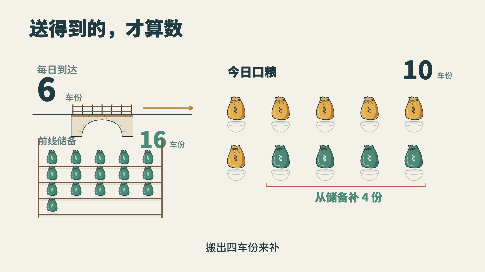

# 粮在后方，前线为何断粮？

用户已认可的二维 MG 讲解，179.9 秒，1920×1080，60fps。本例作为讲解制作水准的参考：造型与排字细致，动作交代过程，前后画面保持对应，丰富内容有清楚的观看次序。

参考这些工作的完成度，按当前内容重新选择讲法、主体、构图、媒介和节奏。本例的粮袋、侧面场景、配色、九段顺序、布局和秒数均不成为后续作品的预设；共同画风与正式交付仍由[画法](../../references/art.md)和[制作接口](../../references/delivery.md)拥有。

## 看什么

从军队停在城外进入问题，跟着一份粮区分存量、在途与储备；再改变桥的通过量、往返时间和每日结余，逐层解释前线为什么会缺粮。地形和数值都是明确标注的假设模型，不提供战役史实或运输制度依据。

| 章节时窗 | 场景与对象变化 | [源码](src/film.js)入口 |
|---|---|---|
| 0—17.48秒 | 城池与停下的进军方向提出问题；拉开后方与前线，一份粮取得焦点 | `sceneQuestion` |
| 17.48—34.21秒 | 开仓、装车、行进、过桥、卸粮；跟车观察后退回共同场景，分清存量、在途与储备 | `sceneJourney` |
| 34.21—53.76秒 | 窄桥移入数量图，六份进入十个用粮位置；四份从储备补入，再演出消耗，剩下十六份 | `sceneBottleneck`、`useUnit` |
| 53.76—72.79秒 | 每日四份从储备离开，五天耗尽；第六天再出现缺口，已经无粮可补 | `sceneReserve` |
| 72.79—91.23秒 | 上游等待的车增加，桥后通过量保持六份，显出增加库存与改变瓶颈的区别 | `sceneMore` |
| 91.23—115.96秒 | 同一组六十辆车沿道路轮转；往返六天变十二天，日均十份改为今天、明天各五份 | `sceneDistance` |
| 115.96—137.04秒 | 十份送到并消耗，空仓持续保留；次日运输中断，零储备不能补缺 | `sceneBalance` |
| 137.04—157.61秒 | 十二份中十份消耗，两份入库；第二天保留原两份再加入两份，随后压缩重复积至二十，再分两天耗尽 | `sceneRebuild` |
| 157.61秒—结束 | 回到同一条补给线，把到达量、周转与储备接回进军的条件 | `sceneDecision` |

## 动作怎样留下结果

在[场景源码](src/film.js)中查 `sceneBottleneck`。旧读数退出，桥从场景位置移入数量图，新标签和粮袋随后进入。同一桥梁接住“这处限制每天送到多少”的问题。代码分别计算场景退场、桥位移、数量图入场与粮袋行程。

在同一场景中查 `smallStockPoint`、`demandPoint`、`arcTravel` 与 `useUnit` 怎样连接来源、去向和消耗。四份粮离仓时库存依次递减，补足的结论在抵达后出现，仓内十六份继续保留。

`sceneRebuild` 先展开一天的到达、消耗与余粮入库，第二天保留旧两份，再加入新两份。新粮落位后才计入储备。熟悉的重复随后加快，重排为更大的储备参照。用本题的关系决定怎么表示、需要演示几次。

## 造型与完整画面

`src/graphics.js`的`warehouse`、`cart`、`ox`、`bag`、`bridge`和`camp`完成建筑、器物与环境；`world`保留共同场景，镜头只改变观察范围。轮廓、结构线、材料色、字重和留白在整幅画面中协调，近景展开结构，远景保留辨识。





用截图核对造型、画面分量和对象对应，再沿[图件源码](src/graphics.js)查结构，沿[场景源码](src/film.js)查动作和承接。周转图中的六十辆车在小屏上较小，可放大原截图检查细节。

## 工程复现

维护案例工程时，可在安装项目依赖后从仓库根目录运行构建，结果写入指定目录。

```bash
node packages/templates/vox-explainer/examples/supply-mg/build.mjs /tmp/vox-supply-mg
```

案例原文与时序见 [narration.json](narration.json) 和 [timing.json](timing.json)，工程所用素材与许可见[CREDITS.md](CREDITS.md)。正式章节沿当前工作单与模板接口制作。
