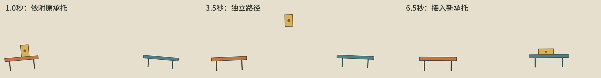

# 制作与交付

本文件拥有共同候选和动画接口，并按当前动作路由所需工具。创作路线与调用时点由[作者入口](../AUTHOR.md)组织，专业判断见[创作方法](vox.md)；工具按输入依赖执行，不必一次读完全部工具说明。

一份`treatment`保存整段作品。字段见[结果合同](../../../../contracts/vox-explainer-treatment.schema.json)，正常候选外壳与提交沿author-beat。

`design.md`是当前工作单`scratchPath`内的制作工作稿，其写入、读取、修订及同源制作由[作者入口](../AUTHOR.md#构思与制作)安排。它不是`treatment`字段，不加入`assetRequests`或P4资源；下面接口只交付当前候选的实际设计。

`templateContext.audio.file`是正式P2原声音频的绝对路径，`startMs / endMs`是本段在该文件中的播放窗口，`sha256`沿用原交接身份。创作与卡点使用本单正式口播、Cue时间戳和已投递的实测短语时间。预演读取同一文件和窗口，复用原配音与时长。

- `templateId: "vox-explainer"`。
- `objective`：本段让观众明白什么。
- `appearance`：从本单templateContext取得字体与外观身份。`art: "editorial-cutout"`与`tone: "neutral"`是现行合同标识，共同风格按[画法](art.md)落实；结合本题对象与表达需要填写本段`palette`。新上下文已提供固定的`background / ink / paper`，保留这些底板与字线颜色；作者填写`accent / secondary`及图形实际需要的其它角色色、材料色。渲染器使用同源固定底板。
- `continuity`：本段时期、地点、人物与道具，遵守本单事实。`carryToNext`仅在有后续复现提示时填写，不代表下一正文段自动继承；已有内容保留。
- `moments`：将动画讲法中的关键动作、状态转变或理解发现记为`{id:"M001",purpose,sourceRefs}`，`purpose`写清本次可见变化或新认识，再选择对应Cue；一项可以跨多句，一句也可包含多项，不把口播分段自动复制为moments或一张张说明页。
- `scene.markup`：整段动画的场景、对象、图件与图文结构，保存为完整HTML片段，可含CSS、SVG、Canvas和图片。自由布局，不分固定元素类别。
- `scene.animation`：用原生JavaScript编排对象、图解、镜头与状态变化，可按表达需要非线性组织；播放仍由本段统一时钟定位。
- `assetRequests`：交付本段实际使用的图片，没有图片时为空数组；素材组织可参考[素材与动作](creative/production.md#素材与动作一起设计)。

## 按需工具

| 当前动作 | 读取 |
|---|---|
| 绑定moments、使用实测短语 | [Cue与句内时序](tools/cues.md) |
| 制作二维镜头、动作错时与联动 | [运动实现示例](tools/motion.md) |
| 生成、导入、裁件及摆放图片 | [图片接口](tools/images.md) |
| 使用Three.js并与SVG协作 | [三维接口](tools/three.md) |
| 纸面、标注、字体测量和数值 | [图文工具](tools/graphics.md) |
| 预演、取帧、导出及临时收字 | [预演接口](tools/preview.md) |
| 地图、路线、旁图和兵棋工具 | [空间工具入口](../spatial/README.md) |

## 画布与动画

从`templateContext.renderContext`取画幅与`safeArea`。以完整画幅组织场景，`safeArea`用于安排关键内容、避让字幕及画面边缘；地图外框和底图按[地图对象构图](spatial.md#地图对象构图)展开。

每段在独立Shadow DOM中，markup的根样式用`:host`，内部ID和CSS不会影响其它段。颜色变量为`--background`、`--ink`、`--paper`、`--accent`、`--secondary`及本段其它角色色，用如`fill: var(--accent)`的CSS取值。实字体用`var(--font-body)`与`var(--font-title)`，字重用`var(--font-body-weight)`与`var(--font-title-weight)`。

底板与外部进出场由模板及原转场消费者提供；scene内层容器与Canvas保持透明，不用`:host`改写底板，也不以满幅底色、地台或滤镜覆盖它。主体、局部环境、图解展开、镜头与内部换景由作者设计，可连续变化、并行比较或转换表示。

统一底板不规定固定版式，也不要求主体四周始终留出一圈空白。按当前观察取近景或裁出暂时无关的部分，让作用处取得足够面积；阅读层与观看窗口分开，关键内容和字幕仍各有空间。留白服务本镜的主次，不用缩小全部对象来保留同一张总览。

`scene.animation`可直接使用：

| 接口 | 用途 |
|---|---|
| `root`、`select(css)` | 取得画面根或元素；select单个命中返回节点，多个返回数组，无命中报错 |
| `gsap`、`timeline` | 原生GSAP与本段受控时间轴；动画接到timeline，通过select传节点 |
| `THREE` | 随模板打包的Three.js命名空间，在本段Canvas中创建三维主体、相机、灯光与材质；见[三维与SVG协作](tools/three.md#三维与svg协作) |
| `cue("M001")` | 该观看变化所选Cue的start或end绑定时刻，相对本段、单位秒 |
| `eventTime("E001")` | 本段scene.events中的画面动作时刻，相对本段、单位秒；独立于可选功能 |
| `onFrame(({frame,time,fps})=>...)` | 按指定帧直接绘制Canvas、改变SVG或计算完整状态 |
| `onCleanup(fn)` | 释放临时资源 |
| `spatial` | 数据地图窗口、连续路线、镜头、定位与标签工具，普通讲解和地图推演均可按需调用，见[空间工具](../spatial/README.md) |
| `assets` | Map，按AR编号读取图片的尺寸、可见范围与锚点 |
| `width / height / fps / duration` | 画幅、帧率、本段时长（秒） |

把已设计的对象关系接到这些接口：共同事实或位移由一处状态求出，相关形体、路径和读数读取它；镜头、标签揭示与停顿按观看需要编排。需要整体移动的对象放在同一外层，独立活动件保留局部变换。同一物件改变景别、位置或尺度时，优先连续变换既有对象组；需要换表示或复制时，先对齐承接处的形象、锚点和状态，再安排新旧图件交接。实体层与内容层可以分别控制，避免交叉淡化让两套文字重影或让背景穿过本应不透明的物体。变量、分组与函数只属于当前scene，不另交状态清单。下面仅演示同一进度驱动图形与反馈；markup中需有矩形#shape和结果#result，对象与尺寸按本题填写。

```js
const start = cue('M002'), span = 1.2;
onFrame(({time}) => {
  const progress = Math.max(0, Math.min(1, (time - start) / span));
  select('#shape').setAttribute('width', 320 * progress);
  select('#result').setAttribute('opacity', progress === 1 ? 1 : 0);
});
```

GSAP动画写入提供的`timeline`，或把自建子时间轴加入它，由HyperFrames按本段时间定位。例如：

```js
timeline.fromTo(select('#shape'), {x: 0},
  {x: 320, duration: 1.2, ease: 'power2.inOut'}, cue('M002'));
```

独立的`gsap.to(...)`或未接入的子时间轴会自行播放，不能随本段跳帧复位。当前Shadow DOM内的CSS动画与Web Animations由Renderer按同一时间定位；逐帧函数按当前time计算完整状态，不能依赖前一帧、定时器或未固定的随机数。跳帧、倒放和重进应得到相同画面。不要在markup内放脚本或运行时网络请求。

将一次观看转折的时间保存为`const anchor = cue('M002')`。这个锚点可以对应动作开始、关键变化或结果落定；若设计要让结果在此落定，就从该锚点向前安排动作时长与准备，相关镜头、主体变化、读数与字组仍由同一锚点加各自偏移求值，并保持在本段合法时窗内。不同对象可以错时，但不能把它们各自写成脱离Cue的全段固定秒数；偏移是制作编排，不是新字幕时间或已验证的词级时间。原声时窗变短时，按当前讲法重排动作和停驻，不用整体加速掩盖来不及看清的问题。地图内部的CSS与Web Animations也沿同一时钟定位；需要随地理投影更新的位置在await map.seek之后计算。

完整混合素材的实现可按需查看[滑轮样片](../examples/pulley/README.md)：`art.mjs`把木桶、吊接与代码机构放在共同坐标中，`animation.js`从位移求出绳路、转轮和读数，再安排不同观看重点。借用适合本题的连接方式，具体模型和节奏自行设计。

同一元素的显隐由同一处控制。用SVG的`opacity`属性驱动时，初态也写在该属性上；不要再用CSS类固定`opacity:0`覆盖动画，导致对象始终不可见。

字组和标注的进入、停驻、退出或替换同样写入原`timeline / onFrame`，需要持续的依据按当前用途保留。逐帧函数由当前时间计算完整显隐与内容，不能只在越过进场点时置为可见而遗漏后续退出与回看状态。上面的结果揭示示例只演示一个变化；其后是否保留及如何交给下一观看重点，按本段设计继续编排。

### 附着、脱离与换表示

需要把同一物件带到另一处、改变形状再接入新关系时，看[完整二维scene](../examples/parcel/attachment-scene.mjs)及下面的实际过程。它用两个移动、转动、缩放的承托和同一个带圆点的物件示意坐标手艺；几何形状、三段编排和8秒时长均不是当前作品的画法或节奏要求。



代码先求父物当前位姿，再把局部锚点经缩放、旋转和平移投到世界坐标；SVG同组嵌套可让浏览器执行相同变换，独立图层则显式求这个坐标。脱离时用`sourceAt(release)`固定实际离开位置，飞行终点用`receiverAt(contact)`取得实际接触位置，另排中间通路；接入后改用`receiverAt(time)`跟随目标，不再沿两端插值。这个例子把路径抬到两个承托上方，当前场景仍须按实际轮廓给人物、读数和作用处留出通路。

形变时，示例的矩形从底边中心向上展开，宽高改变而接触点保持在局部`(0,0)`；代码画件用当前轮廓求锚点，图片则从实图可见边界及已定锚点求位置。外层镜头最后统一作用于同一场景，独立叠加层再按当前投影定位。绘制顺序与路径分别安排：需要从后面经过就放到相应遮挡层，需要在前面保持可见就给它实际通路；换层本身不补出被挡住的动作。这个示意只证明坐标与接合，完整作品的造型、构图、主次及过程可见性仍在本题原试制中完成。
