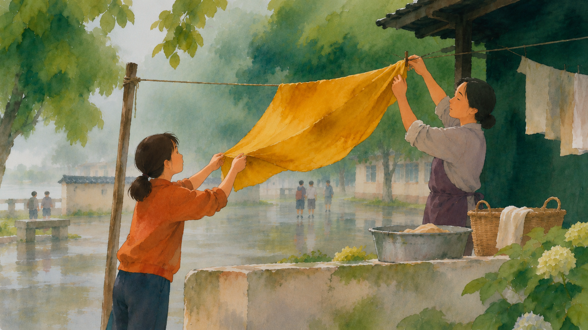

# 湿画法水彩

取《伞：一场关于“自我”的视觉诗学》开场暖色段的画法。近处的金黄和朱橙由相邻的墨青、苔绿及湿石色托住，浅灰绿集中在远处的空气和受天光的表面。湿处让色边交融，干后只在手势、衣褶和物体连接处落细线。肤色、木料和石面随现场照明变化。



| 包内参考 | 可复用的画法 |
| --- | --- |
| [院中收布](references/assets/courtyard.png) | 檐下暗部与浅灰绿远层形成纵深，主动作上的布和衣袖留浓色。 |
| [河埠系船](references/assets/river-landing.png) | 墨青湿岸保留结构，断续的反光跟随石面和水面，粗绳在关键接触点收边。 |
| [摊前交物](references/assets/market-stall.png) | 灯下暖色集中在手、包裹和近处木面，檐外仍是浅绿灰散射光。 |

以上为原生 ImageGen 生成的新场景。研究用原帧取自 [即梦原片](https://jimeng.jianying.com/ai-tool/work-detail/7663562065310731558?workDetailType=ShowcaseVideo&itemType=210) 的 00:17、00:19、00:23 和 01:02。样图中的人物和器物只提供画法参考。

新节目未指定画风时，P0 默认选择本包。需要明确选择时，可在节目委托中填写：

```yaml
visualPackage:
  visualPackageId: wet-watercolor
  version: "1.0.0"
```

[清单](visual-package.json)登记正文、片头和封面方案及固定参考图。[画法](style.json)由现有图片入口编译。[渲染配置](render/tokens.json)提供字幕和标题字体、配色及线条参数，字体随附[来源与许可](render/fonts/LICENSES.md)。全画幅和讲解具象图件按本集内容设计，封面布局沿所选 Cover。
